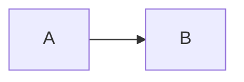

## The agent loop {#agent-loop}

:::maturity{level="established"}
Loops are established.
:::

```python title="loop.py"
while True:
    break
```



## Tools {#tools}

:::vendor{name="Example"}
Vendor note.
:::
